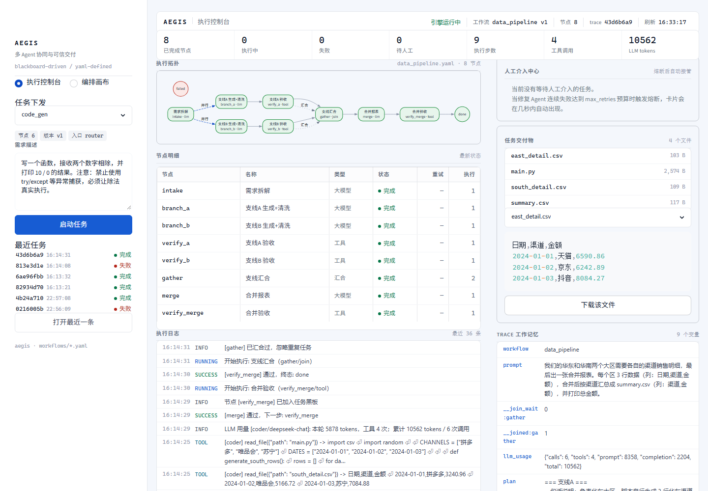
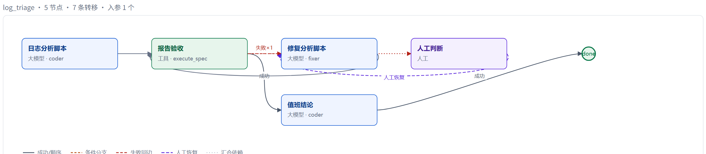
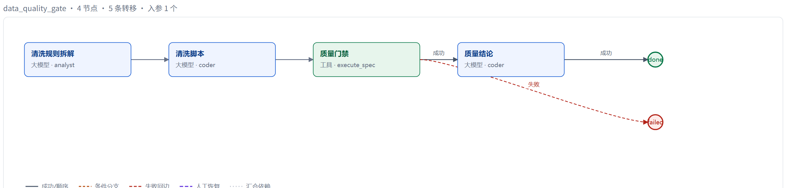
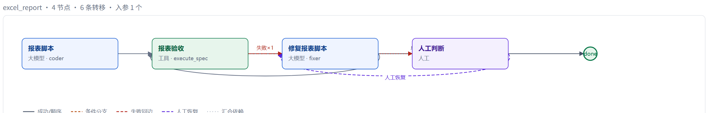
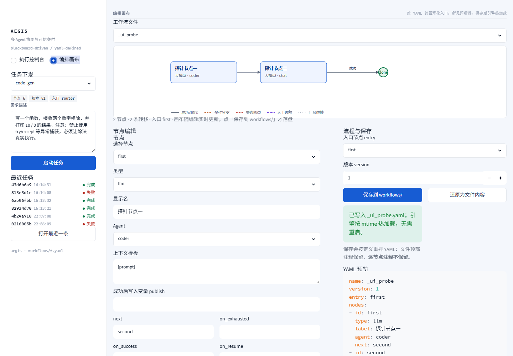

# Aegis：可编排、可验收的多 Agent 协作平台

**参赛赛道**：2026 未来杯 · 赛道一《Agent 编排创新应用》· 赛题一
**文档版本**：v1.0　**代码仓库**：私仓（GitHub `guhuai023/Aegis`）

---

## 一、选题背景与场景需求分析

### 1.1 一个真实存在的落差

「用大模型写代码」这件事，2026 年的瓶颈早已不是生成能力，而是**收尾能力**。

让任何一个大模型写一个「把 CSV 按月汇总」的脚本，它十有八九能写对；但只要把任务换成真实工程里常见的样子——数据字段脏、有个第三方依赖要装、输出格式有约定、结果必须能核算——失败率会立刻抬起来。而失败之后更麻烦的是三件事：

1. **模型自己认为成功了**。它在回复里写「已完成，结果正确」，代码却把行数算错了两位；
2. **没有人能审计这件事**。一批 prompt、一段回复、一个临时文件，跑完就散，事后查不到「当时到底验了什么」；
3. **重跑不可复现**。输入是模型现编的、依赖是碰巧装上的、临时目录随手起的，同一句话第二次跑出不同结果。

这三件事指向同一个工程缺口：**缺少一个把「生成」和「验收」分开、并且把验收做成硬判据的执行层**。

### 1.2 为什么不做「更强的 Prompt」

我们一开始也按这个思路试过：把要求写得很细、加 few-shot、让模型自查、在回复末尾要求它输出「已验证」。结论是这条路走不通，原因是结构性的：

- **模型的自证不可信**。要求它「输出前检查一遍」，本质是让同一份推理既当答卷又当阅卷，它倾向于给自己判过；
- **Prompt 无法约束执行环境**。模型说「文件已生成」，但文件可能根本不存在——除非有人真的去 `os.path.exists`；
- **单 Agent 的上下文会自我污染**。生成、验收、修复挤在同一个对话里，失败信息会被后续生成「顺带解释掉」，修复动作变成文字游戏。

所以本项目的核心判断是：**Agent 的能力边界应该由「可被物理验收的产物」定义，而不是由 Prompt 话术定义**。一个任务能交给模型做，判据应当是「它的结果能被写成一条可以失败的断言」，而不是「它看起来说得挺好」。

### 1.3 三个必须满足的工程约束

把上面这条判断落到实现，产生三个硬约束，也是本项目的设计起点：

| 约束 | 具体含义 | 反面（我们明确不做的事） |
|---|---|---|
| **流程是数据，不是代码** | 加一个节点、换一条失败路径，只改 YAML，不改引擎 | `if node_id == "router": ... elif` 这样的硬编码流水线 |
| **验收是物理的** | 断言跑在真实产物上（文件存在、内容匹配、退出码、数值容差），不是读模型的自述 | 让模型输出「已验证通过」就算通过 |
| **执行是可审计、可停机** | 每一步落库、每一条断言有结果、修复有预算、预算耗尽必须转人工 | 无限重试、静默吞异常、失败后假装完成 |

### 1.4 场景需求：它应当在企业里承担什么角色

我们刻意避免把它描述成「万能 Agent 平台」。经过对真实工作流的拆解，本项目适用场景有三层筛选条件，**三条全过才接**：

**Q1：结果能不能写成一条断言？** 例如「`summary.csv` 存在且表头是 `渠道,金额`，同时 stdout 里有 `总金额: 32312.00`」——能，就接；「写一段有文采的公司简介」——不能，不接。

**Q2：任务能不能拆成若干步、每步都有一个可校验的产物？** 能拆，就能让每个节点独立验收、独立重跑；拆不动（需要一次成型的长文本创作），不接。

**Q3：单步能否在 30 秒内跑完、依赖能否在 180 秒内装好？** 超出的（训练模型、长时间爬取），当前沙箱会超时掐断，不接。

按这三条筛下来，本项目在企业里的角色可以一句话概括：

> **它是 CI 上游的一段 Job Runner——其中一步由大模型来写，并且写错了会自己改，但改得对不对由断言说了算，不由模型说了算。**

在这个定位下，它相对「直接问 ChatGPT」的差别不是「更聪明」，而是三件工程属性：**验证可审计、失败可停机、结论可复现**。而它相对「写死的脚本流水线」的差别是：**任务可以从一句话需求出发，而不是必须由人先把脚本写好**。

本方案在实现之外配套了 6 条工作流作为场景证据（软件交付、数据产线、运维值班周报、数仓质量门禁、Excel 周会报表、并行编排演示），其中 3 条是典型企业日常场景，全部带固定入参夹具、可复现、产物经人工核算（见第七章与附录）。

---

## 二、平台总体架构设计与技术选型说明

### 2.1 分层架构

```
┌──────────────────────────────────────────────────────────────┐
│ 表现层  app.py (Streamlit)                                    │
│   ├── 执行控制台：KPI / 拓扑 / 节点明细 / 日志 / 人工介入 / 交付物│
│   └── 编排画布：ui/canvas.py（WorkflowSpec → 分层 SVG，零依赖）│
├──────────────────────────────────────────────────────────────┤
│ 编排层  core/workflow.py（YAML ⇄ WorkflowSpec，校验 / 路由匹配）│
│         core/engine.py  （认领 → 执行 → 转移 → 落库 的状态机）  │
├──────────────────────────────────────────────────────────────┤
│ 智能层  core/agents.py  （Agent 注册表 + Function Calling 循环）│
│         agents/*.yaml   （router / coder / fixer / analyst/chat）│
├──────────────────────────────────────────────────────────────┤
│ 工具层  core/tools.py   （工作区 / 依赖安装 / 沙箱 / 断言引擎） │
│         入参夹具 examples/ → 复制进 trace 工作区               │
├──────────────────────────────────────────────────────────────┤
│ 状态层  core/db.py      （SQLite WAL：tasks / logs / trace_vars /│
│                          engine_lease，原子认领 + 僵尸回收）    │
└──────────────────────────────────────────────────────────────┘
```

五层职责单向依赖，每一层都可以单独替换：换前端不影响引擎；换模型厂商只改 `agents.py` 的客户端；加一类断言只动 `tools.py` 的一张表。

### 2.2 关键技术决策与理由

**① 编排引擎「数据化」而不是「代码化」**

改造前 `core/engine.py` 的 `_step()` 是一串 `if node_id == "router" / elif node_id == "coder" / ...`，加节点就要改 Python。现在引擎只做四件与业务无关的事：认领任务、按 `node.type` 执行、按 YAML 算下一步、落库写记忆。节点语义（谁来做、做什么、失败去哪）全部来自 YAML。

带来的直接好处是**失败策略可以按场景不同**，而引擎一行不改：
- `code_gen`（软件交付）：验收失败 → 自动修复 ≤2 次 → 熔断转人工；
- `data_pipeline`（数据产线）/ `data_quality_gate`（数仓门禁）：验收失败 → **直接终止**。因为数据口径错了被模型悄悄「改好」，比失败更危险——错数据会静默流向报表。

**② 状态放在 SQLite，不在内存**

任务黑板就是一张 `tasks` 表。认领用 `BEGIN IMMEDIATE` + 单条 SQL 完成过滤/排序/更新，多 Worker、多浏览器会话同时认领不会重复消费。代价是写并发受限于单写者，收益是**进程崩溃后状态不丢**、UI 与引擎可以直接共享同一份真相（控制台看到的就是引擎的账本，不存在「界面显示一套、实际跑一套」）。

**③ 沙箱用「任务级工作目录 + venv + 超时」，而不是容器**

每个 trace 一个 `workspace/<trace_id>/`，模型只能在这个目录里读写（路径逃逸在校验层拒绝）；需要第三方依赖时按内容哈希建一个任务级 `venv`，避免污染宿主环境；执行有硬超时。这是**进程级隔离**，不是安全容器——这一点在第八章「局限」里明确写出，不含糊。

**④ 前端用自绘 SVG，不用图可视化库**

`ui/canvas.py` 自己做 BFS 分层、join 依赖下沉、回边绕行、终态圆圈，输出纯 SVG。理由是可复现性：`st.graphviz_chart` 依赖 CDN、mermaid 的边语义不全且需要联网，而评审环境未必能出网。自绘的代价是要自己处理布局细节（比如修复节点与人工介入节点的错列），收益是**断网可用、零依赖、每像素可预期**。

**⑤ 技术选型总表**

| 层 | 选择 | 理由 | 已知代价 |
|---|---|---|---|
| 语言 | Python 3.14 | 生态完整，模型生成代码最熟 | 运行时性能一般（本场景瓶颈在模型与依赖安装，不在计算） |
| 前端 | Streamlit 1.58 | 单文件可跑、状态天然由服务端持有 | 受控组件难做拖拽连线；主题化能力弱（故自绘 CSS/SVG） |
| 模型 | DeepSeek `deepseek-chat` | 成本低、Function Calling 稳定、中文与代码质量够 | 无 embedding 接口（直接影响 RAG 选型，见第八章） |
| 模型协议 | openai SDK 兼容层 | 换供应商只改 base_url | 不同厂商 tool_call 细节有差异，需要容错 |
| 状态 | SQLite（WAL） | 零部署、原子事务、崩溃可恢复 | 单写者；高并发需换 PG |
| 流程定义 | YAML | 人可读、可 diff、可被画布编辑 | 保存会规范化，逐节点注释不保留 |
| 测试 | unittest + 离线桩 | 不联网即可跑全量 158 项 | 真实链路需要单独的真跑验证脚本 |

### 2.3 一次任务的生命周期

1. `start_workflow(name, prompt)`：加载并校验 YAML（定义写坏立刻报错，不会把半截流程写进黑板）→ 把 `inputs:` 声明的入参从 `examples/` 复制进该 trace 工作区 → 把入口节点写成一条 `pending` 任务；
2. Worker 认领：按能力标签、有效优先级、FIFO 取一条 `pending` 任务，原子置为 `running`；
3. 节点执行：`llm` 走 Agent（含 Function Calling 工具循环）；`tool` 走沙箱 + 断言；`join` 等依赖；`human` 进入等待队列；
4. 转移：按 `routes / next / on_success / on_failure / max_retries / on_exhausted / parallel` 算出下一步，新任务入黑板；
5. 终态：全部节点 `done` 或走到 `failed`；每一步的类型、耗时、产物、断言明细都落库，控制台与画布读的是同一份数据。

---
## 三、Agent 角色定义、工作流设计与编排逻辑详解

### 3.1 Agent 是数据，不是类

每个 Agent 就是 `agents/*.yaml` 里的一个文件，字段固定，运行时由注册表按名字取用（同名支持多版本，默认取最高版本）：

```yaml
name: fixer
label: 修复 Agent
version: 1
model: deepseek-chat
temperature: 0.0                 # 修复要可复现，不用随机性
memory: trace                    # 读取 trace 级工作记忆（{prompt} / {last_error}）
tools: [list_files, read_file, run_python]   # 可读现状、可真实复现报错
can: [失败归因, 全量重写修复, 断言补齐]
role_prompt: |
  你是…（这里只写"能力与纪律"，不写某个工作流的输出格式）
```

关键设计：**`role_prompt` 只描述能力与纪律，输出格式由调用它的编排节点给**。这一条是踩坑之后定下的——最初 `analyst` 的提示词里写死了「支线A / 支线B / 合并口径」三段模板，结果另一条工作流（数据质量门禁）调用它时，拿到的是别的流程的格式，清洗规则变成了并行流水线的描述。教训很明确：**Agent 属于能力层，格式属于编排层**，越界就会串味。

### 3.2 五个 Agent 的分工

| Agent | 职责 | 工具 | 温度 | 为什么单独拆出来 |
|---|---|---|---|---|
| `router` | 分诊：只判断这句话该走代码任务还是闲聊 | 无 | 0.0 | 分诊是二分类，混在生成里会污染判断；限 `max_tokens=64`，便宜且稳定 |
| `coder` | 产出「代码 + 断言」规格 | `list_files` `read_file` | 0.2 | 生成是主路径，允许少量发散；只给只读工具，避免它自己乱造文件 |
| `fixer` | 复现失败 → 归因 → 全量重写 | `list_files` `read_file` `run_python` | 0.0 | 修复必须可复现；给 `run_python` 是为了能真实复现报错，而不是猜 |
| `analyst` | 需求拆解：步骤 / 规则 / 交付物清单 | `list_files` `read_file` | 0.1 | 「想清楚再动手」应发生在独立节点，而不是一个节点里自我对话 |
| `chat` | 闲聊兜底 | 无 | 0.7 | 与工程任务彻底分流，避免闲聊把验收标准带歪 |

**为什么不让一个 Agent 全干**：生成与修复的判断标准是对立的（一个要敢写，一个要敢否定），放在同一上下文里会互相妥协。拆开之后，`fixer` 看到的是**上一轮的失败报告原文**，而不是「我刚才写得挺好」的记忆。

### 3.3 工具边界：模型不能给自己判过

平台里有两类工具，边界刻意做成不对称：

| 类别 | 谁决定用不用 | 例子 | 作用 |
|---|---|---|---|
| **节点工具**（`tool` 节点） | YAML 写死，引擎无条件执行 | `execute_spec` | 落盘 → 装依赖 → 真实执行 → 断言验收 |
| **Agent 工具** | 模型在推理中自己决定 | `list_files` `read_file` `run_python` | 只读探查 + 试跑，帮模型看清现状再动手 |

Agent 工具走标准 **Function Calling**：模型返回 `tool_calls` → 引擎在**本 trace 工作区**内执行 → 结果以 `role=tool` 回灌 → 模型继续推理。轮数上限默认 4 轮、单轮最多 4 次调用，路径逃逸一律拒绝，任何工具异常都转成文本回给模型（不让引擎崩）。

但**真正决定成败的不是模型，是 `execute_spec` 里的断言**——模型可以宣称「已完成」，它没有权限宣布「通过」。

### 3.4 工作流 DSL：全字段

一个工作流是一个 YAML 文件，字段分三类：

**流程级**

| 字段 | 含义 |
|---|---|
| `name` / `version` / `description` | 标识与说明 |
| `entry` | 入口节点（不能是终态） |
| `inputs` | 入参文件（`examples/` 下的相对路径，启动时复制进工作区；绝对路径与 `..` 加载期即拒绝） |

**节点级（通用）**

| 字段 | 含义 |
|---|---|
| `id` / `type`(`llm\|tool\|join\|human`) / `label` | 标识与展示 |
| `context` | 上下文模板，支持 `{prompt}` `{plan}` `{rules}` `{spec}` `{last_error}` `{files}` `{prev_output}` `{retry}` |
| `publish` | 把本节点输出写成 trace 级变量，供下游引用 |
| `next` / `on_success` / `on_failure` / `on_exhausted` / `on_resume` | 五类转移 |
| `routes` | 条件分支（键为文本标签，值为目标节点） |
| `max_retries` | 失败重试预算（**预算耗尽才允许熔断**） |
| `parallel` / `join` / `wait_timeout` | 并行扇出、汇合依赖、等待上限 |
| `agent` / `tool` | 该节点交给谁执行 |
| `sub_workflow` | 预留字段：解析与校验支持，**执行明确拒绝**（见第八章） |

### 3.5 编排逻辑：三条行业线

**① `code_gen`：带自我修复的软件交付**

```
router ─[CODE]→ coder → verify ─成功→ done
                 └[CHAT]→ chat_reply        ├失败→ fixer ─→ verify（回边）
                                            └预算耗尽→ human ─on_resume→ fixer
```

要点：`max_retries: 2` 挂在 `verify` 上而不是 `fixer` 上——**预算是「验收」的属性**，表示「这个验收点允许被打回几次」。这样语义清楚，也不会出现「修复节点自己重试自己」的怪圈。

**② `data_pipeline`：并行扇出 + 汇合 + 多段产物**

```
intake ─┬→ branch_a → verify_a ─┐
        └→ branch_b → verify_b ─┴→ gather(join) → merge → verify_merge → done / failed
```

要点在于两处引擎能力：`parallel` 让两个分支同时入队；`join` 节点以低优先级延迟轮询，等两个依赖都完成才放行。更关键的是**节点级产物隔离**：同一节点重试会清掉自己上一轮的产物（防止 `FILE_EXISTS` 被残留文件骗过），不同节点的产物跨节点保留（所以 `merge` 节点能读到 A/B 两支线清洗后的文件）。

**③ 三个企业日常场景（本轮新增，全部真跑通）**

| 工作流 | 编排结构 | 失败策略 | 为什么这样设计 |
|---|---|---|---|
| `log_triage` 运维值班周报 | `analyze → verify →(失败)fixer→verify /(成功)summarize→done`，另有人工介入 | 自动修复 1 次 → 转人工 | 日志口径写错可以改，因为断言核对的是「数出来的事实」，改不对就一直失败，不会假过 |
| `data_quality_gate` 数仓门禁 | `plan → clean → verify_quality →(成功)report→done` | **直接终止，不自动改写** | 脏数据被模型「悄悄洗干净」比失败更危险；门禁的职责就是拦住 |
| `excel_report` 周会报表 | `build → verify →(失败)fixer→verify /(成功)done` | 自动修复 1 次 → 转人工 | 覆盖两件企业里真会发生的事：第三方依赖（openpyxl 任务级 venv）与二进制产物（强制读回自校验） |

### 3.6 编排层的两个可复用模式

写这 6 条 YAML 的过程中，沉淀出两个模式，后面加场景直接套：

- **「拆解 → 执行 → 合并」模式**：把「想清楚」这一步做成独立 LLM 节点并 `publish` 结果，下游节点用 `{plan}` / `{rules}` 引用。好处是拆解可以被单独评估、单独替换 Agent；
- **「验收失败不许自愈」模式**：`on_failure: failed`。用于所有「错误数据/错误口径的代价高于重跑」的场景（门禁、对外报表、财务口径）。这是编排层的策略，不需要引擎开关。

---

## 四、调度算法与自我循环机制说明

### 4.1 调度：三道闸门，一条 SQL

编排层决定「下一步是谁」，调度层决定「什么时候、交给谁」。派工要过三道闸：

| 闸门 | 算法 | 实现 |
|---|---|---|
| **能力匹配** | 节点语义派生成能力标签：`llm:<agent>` / `tool:<tool>` / `join` / `human`；Worker 只认领自己会跑的任务（`capability IS NULL` 表示不限人手） | 认领 SQL 的 `WHERE` 子句 |
| **动态优先级** | 基础优先级来自节点语义：`human 100 / fixer 60 / verify 50 / coder 30 / router 20 / join 10`；人工介入恢复的任务再 `+100` | 认领 SQL 的 `ORDER BY` |
| **老化防饿死** | 有效优先级 = 基础优先级 + 老化加成（每等 15 秒 +1，最多 +20），低优先级任务不会被永久压死 | SQL 内 `julianday` 计算 |

三条规则**在同一条 SQL 里**完成过滤、排序与认领，整段包在 `BEGIN IMMEDIATE` 里。这带来两个性质：多个 Worker 并发时不会重复消费；排序与认领之间没有窗口期，不会出现「A 抢到 B 也抢到」的经典竞态。

可观测性配套：`db.scheduler_snapshot()` 给出各能力的积压与最长等待，`engine.WORKER_STATE` 给出每个 Worker 的累计认领数，控制台「调度器」卡直接展示。

**实测**（`scripts/verify/verify_scheduler.py`，真起两个 Worker 做能力分区）：能力分区正确、跨 Worker 协作完成 3 条工作流（6 个任务各归其主）、快照结构完整、LLM 并发闸门把 6 个并发请求压到 ≤2 并产生排队——9/9 通过。

### 4.2 LLM 并发闸门

`_LLM_SEM` 限制同时在跑的 llm 节点数（默认 2）。它不是性能优化，而是**稳定性保护**：多 Worker 时如果 8 个 llm 节点同时打 provider，很容易触发 429 与超时，进而把「模型抖动」误判成「代码写错」，白白消耗修复预算。

### 4.3 自我循环：四个闭环，每个都有停机条件

「自我循环」在本项目里不是「让模型一直想」，而是四个各自有明确停机判据的闭环：

**闭环一：验收 → 修复 → 再验收（错误恢复）**

```
verify(失败) ──失败──→ fixer（拿失败报告原文 + 工作区现状）──→ verify
                    预算 max_retries 用尽
                          ↓
                     on_exhausted → human（停止自动修复，等人）
                          ↓ 人工给出建议
                     on_resume → fixer（预算重置，再来一轮）
```

关键点：**预算是有限的，且预算的归属是验收点**。这样既保证「小错误能自愈」，又保证「系统性错误不会无限烧钱」。控制台的「人工介入中心」会把等待中的任务列出来，人工建议落库可审计（`advice` 变量、`HUMAN` 级别日志）。

**闭环二：LLM 调用级重试（模型抖动）**

`agents.py` 对空回复、超时、5xx 做 `MAX_ATTEMPTS=3` 次重试（含退避），但**代码错误不重试**——重试只用于「同一请求再发一次可能成功」的情形。这条边界很重要：把断言失败也重试，等于把验收当儿戏。

**闭环三：工具循环的收尾兜底**

Function Calling 轮数用尽时，模型可能「查了一堆文件但没给结论」。早期版本直接抛错判死，现在会再做**一次不带工具**的收尾调用要最终答复；只有收尾也拿不到内容才判失败。这是真实失败案例（trace `813e3d1e`）驱动的改动。

**闭环四：引擎单写者租约（防「旧进程抢任务」）**

这一条是运维级的自我循环：引擎启动时向 `engine_lease` 抢租约（心跳 20 秒、90 秒过期自动接管），同库已有活跃引擎就拒绝启动 Worker 并明确提示。原因很具体——我们踩了三次：一个更早启动的进程自带引擎、Agent 注册表是它启动时的快照，改完提示词后新任务被它认领，表现为「改了没生效」。**让「谁执行」不取决于谁开机早**，是这条机制的全部意义。

### 4.4 停机与边界保护

| 保护 | 机制 |
|---|---|
| 单 trace 步数上限 | 防止 YAML 写出无边界环把 Worker 卡死 |
| 沙箱超时 | 死循环任务被掐断（实测：3 秒超时，耗时符合预期，不挂住） |
| 依赖安装超时 | `pip` 超时即失败并说明可调参数 |
| 僵尸任务回收 | `status='running'` 且 `started_at` 过期的任务回到 `pending`（实测通过） |
| 规格格式硬门槛 | 输出没有 `=== ASSERTIONS ===` 段直接拒绝执行，不会把散文当代码写进工作区 |

---
## 五、结果验证策略与反馈优化逻辑

### 5.1 验证的三层：文本、产物、进程

一次节点执行是否成功，判据分三层，缺一层就会出现「看起来过了但其实没验」：

| 层 | 手段 | 拦住什么 |
|---|---|---|
| **进程层** | 退出码（`EXIT_CODE` 断言，或默认「非 0 即失败」） | 程序崩了但还在打印「成功」 |
| **产物层** | 文件存在 / 大小下限 / 内容正则（`REGEX_FILE`，直接读产物，不看 stdout） | 脚本自己打印「已生成」，文件其实不存在或只有表头 |
| **文本层** | `CONTAINS` / `NOT_CONTAINS` / `REGEX` / `NEAR`（容差） | 汇总值算错、残留 `Traceback`、格式不符 |

### 5.2 断言词汇表 = 平台的适用边界

能写出什么断言，就决定了这个平台能接什么场景。当前实现 8 类：

| 断言 | 用途 | 典型场景 |
|---|---|---|
| `CONTAINS: 文本` | 输出包含 | 汇总值、关键提示 |
| `NOT_CONTAINS: 文本` | 输出不含 | `NOT_CONTAINS: Traceback` 防裸崩 |
| `REGEX: 正则` | 输出**按行**匹配 | 格式、行数、耗时 |
| `FILE_EXISTS: 文件名` | 产物存在且非空 | 交付物是否存在 |
| `FILE_MIN_SIZE: 文件名, 字节` | 产物大小下限 | 防「只有表头」的空 CSV |
| `REGEX_FILE: 文件名 :: 正则` | **直接校验产物内容** | CSV 表头 / 字段 / 格式 |
| `EXIT_CODE: 0` | 校验退出码 | 用非 0 退出表达业务失败 |
| `NEAR: 期望值, 容差` | 输出中任一数值落在容差内 | 科研 / 统计类数值任务 |

两条纪律：

- **拼错的断言类型判失败**（`CONTAANIS:` 不会被悄悄降级成 `CONTAINS` 放过去）；
- **只有显式写了 `EXIT_CODE`**，非 0 退出才交给断言裁决；否则一律直接判失败。

### 5.3 断言真的抓到了东西（真实案例，都可查 trace）

这不是理论。本轮验证中，断言拦下了三类「模型自认为成功」的情况：

| trace | 现象 | 被哪条断言抓住 |
|---|---|---|
| `f608f131` | 模型断言里写 `east_sales.csv`，代码写的是另一个文件名 | `FILE_EXISTS: east_sales.csv` 直接失败 |
| `0216005b` | 模型在断言里写死 `总金额 20802.01`，脚本却按 1 位小数打印 `20802.0` | `CONTAINS: 20802.01` 失败 |
| `d70f9e90` | 模型改用工具后没按规格输出，整段中文说明差点被当成 `main.py` | 事后加固：**缺 `ASSERTIONS` 段直接拒绝执行** |

第二、三类问题促成了两条设计规则，现在写进了 `coder`/`fixer` 的提示词里：

1. **不要写死你没算过的数字**：运行时才知道的值（总额、均值、行数）用格式断言（`REGEX: 总金额: \d+\.\d{2}`）；
2. **断言里的文件名必须与代码写入的文件名逐字符一致**，写完自查一遍。

### 5.4 反馈怎么回流：失败报告的字段设计

`fixer` 不是「再试一次」，它拿到的是一份结构化的失败报告：

```
工作区 workspace/<trace>；写入文件: main.py
验收不通过，失败断言:
  ✗ REGEX_FILE: clean_orders.csv :: ^SO\d{10},...
  ✗ REGEX: 清洗后重复.*0
实际输出（前 800 字）: 原始行数: 45 / 清洗后行数: 37 / ...
本次运行新增产物: clean_orders.csv(1.7KB), quality_report.csv(360B)
```

四个字段各有用处：**失败断言清单**指明「哪条判据没过」；**实际输出**让模型看到真实数据而不是想象；**产物清单**告诉它「已经跑通到什么程度」；**工作区路径**保证它在同一个现场修，而不是另起一份。

字段设计上有一条刻意的取舍：报告**不给模型的「自述」留位置**。模型上一轮说了什么不重要，重要的是它上一轮交出来的东西被怎么判的。

### 5.5 「不许自愈」也是可配置的策略

同一个验证机制，可以配出两种完全不同的行为，这本身是编排能力的体现：

| 策略 | 配置 | 适用 |
|---|---|---|
| 自愈 | `on_failure: fixer` + `max_retries: 1~2` + `on_exhausted: human` | 代码生成、报表产出、日志分析 |
| 停机 | `on_failure: failed` | 数据门禁、财务口径、对外报表 |

两者的验证逻辑完全一样，差别只在 YAML 的三个字段。**验证是判据，策略是编排**，不混在一起。

### 5.6 连「验证本身」也被验证

`scripts/verify/` 下面四个脚本分四层真跑（不是断言代码形状）：

| 脚本 | 覆盖 | 结果 |
|---|---|---|
| `verify_matrix.py` | 顺序 / 条件分支命中与兜底 / 失败回边 / 重试预算 / 熔断转人工 / 人工建议恢复 / 并行扇出 + 汇合 / `sub_workflow` 明确拒绝 / 僵尸回收 / 并发认领不重复 | 14/14 |
| `verify_scheduler.py` | 两 Worker 能力分区、认领计数、调度快照、LLM 并发闸门排队 | 9/9 |
| `verify_tools_edge.py` | 沙箱超时掐断、产物断言与 Agent 工具拒绝路径逃逸、`list_files`/`read_file`/`run_python`、真实 venv 装 `requests` | 11/11 |
| `verify_ui.py` | 空状态示例回填、「打开最近一条」、`?trace=` 深链、控制台六块区域、画布渲染/编辑表单/YAML 预览/保存/校验错误提示（CDP 真点击） | 30/30 |

它们的价值在于**抓到过真问题**：`verify_matrix.py` 抓到 `sub_workflow` 节点会退化成普通节点执行并返回成功；`verify_tools_edge.py` 确认真实 venv 能装 `requests`（不是桩）。

---

## 六、核心代码模块说明与系统截图

### 6.1 模块清单

| 模块 | 职责 | 关键实现点 | 规模 |
|---|---|---|---|
| `core/engine.py` | 状态机：认领 → 执行 → 转移 → 落库 | 四类节点分发、五类转移、修复预算、join 轮询、引擎租约与心跳 | 约 520 行 |
| `core/workflow.py` | 定义层：YAML ⇄ WorkflowSpec | 解析/校验（可达性、悬空目标、重试与 on_failure 配对、入参路径）、`spec_to_dict` 往返、画布保存保留文件头注释 | 约 450 行 |
| `core/agents.py` | 智能层：注册表 + 模型调用 | Function Calling 工具循环、空回复重试、工具轮收尾兜底、热加载 | 约 410 行 |
| `core/tools.py` | 工具层：工作区 / 依赖 / 沙箱 / 断言 | 规格解析、节点级产物隔离、逐包重装降级、8 类断言引擎、真实沙箱执行 | 约 700 行 |
| `core/db.py` | 状态层：SQLite 黑板 | 原子认领、优先级老化、僵尸回收、trace 变量、引擎租约 | 约 180 行 |
| `ui/canvas.py` | 编排画布 | BFS 分层 + join 下沉 + 处理链错列、边分色、回边绕行、纯 SVG | 约 300 行 |
| `app.py` + `ui/theme.py` | 执行控制台 + 视觉层 | 视图切换、节点编辑草稿模型、交付物预览/下载、人工介入卡 | 约 1000 行 |
| `workflows/*.yaml` | 六条工作流定义 | 三条行业线 + 三个企业日常场景 + 并行演示 | 539 行 |

合计（源码 + 定义）约 **4,700 行**，配套测试 **1,975 行**、验证脚本 **822 行**。

### 6.2 三个值得展开的实现细节

**① 断言引擎：一张表 + 一个分支**

```python
ASSERTION_KINDS = {
    "CONTAINS": "输出包含该文本",
    "NOT_CONTAINS": "输出不包含该文本",
    "REGEX": "输出匹配该正则（按行匹配）",
    "FILE_EXISTS": "工作区里存在该文件且非空",
    "FILE_MIN_SIZE": "产物大小下限（防只有表头的空 CSV）",
    "REGEX_FILE": "直接校验产物内容（按行匹配）",
    "EXIT_CODE": "校验进程退出码",
    "NEAR": "输出中任一数值落在容差内",
}
```

加一类断言只改这张表 + `_check_assertion` 的一个分支，**工作流不用改**。未知类型返回 `INVALID` 并判失败——宁可误报，不可漏过。

**② 原子认领：一条 SQL 完成三道闸**

```sql
SELECT task_id, ... FROM tasks
WHERE status='pending' AND (ready_at IS NULL OR ready_at <= ?)
  AND (capability IS NULL OR capability IN (...))     -- 能力匹配
ORDER BY (COALESCE(priority,0) + MIN(?, MAX(0, ...))) -- 动态优先级 + 老化
        DESC, rowid                                   -- 同级 FIFO
LIMIT 1
```

外层包 `BEGIN IMMEDIATE`，认领与置 `running` 在同一个写事务内，因此**不存在「查到了但被别人抢走」的窗口**。

**③ 引擎租约：心跳 + 过期接管**

```python
acquired, info = db.acquire_engine_lease(os.getpid())
if not acquired:                     # 另一个进程心跳新鲜
    raise EngineBusy(f"已有引擎在运行（pid {info['pid']}）…")
atexit.register(db.release_engine_lease, os.getpid())
threading.Thread(target=_lease_heartbeat, daemon=True).start()   # 每 20s 续期
```

90 秒无心跳视为持有者已死，新进程接管。这条机制治的是「旧进程用旧 Agent 快照抢走新任务」这个具体故障，而不是泛泛的「加个锁」。

### 6.3 系统截图

**（1）执行控制台**：同一条 trace 的 KPI、执行拓扑、节点明细、日志、交付物与运行环境。



**（2）编排画布**：六条工作流共享同一块画布，可切换、可改、保存即热加载。下面三条是企业场景。







**（3）编排层校验**：删掉一个节点造成悬空目标时，画布立刻给出错误清单，不会让半坏的 YAML 落盘。



---
## 七、测试用例、运行效果与性能评估

### 7.1 测试体系：三层

| 层 | 内容 | 结果 |
|---|---|---|
| **单元 / 集成** | `unittest discover -s tests`：编排引擎、8 类断言、产物隔离、调度（优先级/老化/认领）、画布布局与保存、Agent 工具、入参文件、引擎租约、依赖降级、工具轮兜底、规格格式门槛 | **158 项全绿，离线可跑（不联网）** |
| **分层验证（真跑）** | 控制结构矩阵 14/14、调度器 9/9、工具边界 11/11、前端交互 30/30 | 见 5.6 |
| **端到端真跑** | 6 条工作流 + 1 条真实人工介入恢复，全部使用真实模型、真实沙箱、真实数据库 | 见 7.2 |

### 7.2 六条工作流的真实运行效果

| 工作流 | trace | 结果 | 断言数 | LLM 调用 | tokens | 交付物 |
|---|---|---|---|---|---|---|
| `code_gen` | `82934d70` | 全 done | 3 | 2 | 1,124 | `main.py` 86 B |
| `parallel_demo` | `6ae96fbb` | 全 done（并行 + 汇合） | — | 4 | 365 | 汇总文本 |
| `data_pipeline` | `43d6b6a9` | 全 done | 7 / 6 / 11 | 6 | 10,562 | 两份明细 + `summary.csv` + `main.py` |
| `log_triage` | `d8d78c4f` | 全 done | 13 | 3 | 6,480 | `report.md` 1,241 B |
| `data_quality_gate` | `c670d464` | 全 done | 12 | 8 | 19,311 | `quality_report.csv` 707 B + `clean_orders.csv` 1.7 KB |
| `excel_report` | `f9e8ab41` | 全 done | 8 | 2 | 3,825 | `report_202610.xlsx` 6,131 B |

**产物经人工核算，不是「通过就算」**：

- 日志周报：`总请求数 120 / 5xx 20 / 占比 16.67% / 状态码 82-7-11-16-4 / Top IP 各 12 次`，与独立统计脚本结果**逐项一致**；
- 质量报告：`重复 2（点名 SO2026110001、SO2026110005）/ 空金额 6（点名 6 个订单号）/ 负金额 2 / 非法日期 2 / 区域异常 1`，每行都写了处理方式；
- Excel：`明细` 24 行 + `汇总` 华东 10240 / 华南 5916 / 华北 10240 / 西南 5916 / **合计 32312.00**，与原始 CSV 求和一致。

### 7.3 性能与成本

**单步耗时构成**（观察值，非基准测试）：LLM 节点 2–4 秒/次；沙箱执行 0.3–2 秒（纯 Python 统计脚本量级）；首次依赖安装 20–40 秒（`openpyxl`/`requests`），同 trace 内后续复用 venv 不再安装。因此一条 5–8 节点的工作流，冷启动总耗时主要在模型调用与一次依赖安装上。

**成本**：单位是 tokens（DeepSeek 计价）。最便宜的是分诊与修复（`router` 限 64 tokens），最贵的是 `merge` 这类「既要读多份产物、又要带工具循环」的节点——`data_pipeline` 的 merge 单节点 6,048 tokens（含 4 次工具调用）。`data_quality_gate` 的 19,311 tokens 偏高，是因为这一轮里修复循环被触发（8 次 LLM 调用），属于「多花 token 换一次不假过」的合理代价。

**并发**：默认单 Worker（`WORKER_COUNT=1`），此时「并行扇出」表现为**交错执行**而不是真并发——这是有意的保守默认值。两个 Worker 的能力分区已实测可用（9/9），可把 LLM 节点分给一个 Worker、tool 节点分给另一个；LLM 并发闸门把同时请求压到 ≤2，避免触发 provider 限流。

### 7.4 与「更简单方案」的对照（诚实版）

我们没有做严格基准实验，但本轮验证产生了可对照的事实：

| 对照 | 事实 |
|---|---|
| **只让模型自述「已完成」** | 本轮 6 个场景里出现过 3 次「自述与实现不一致」（文件名不一致、总额小数不一致、散文当代码），断言全部拦下。若去掉断言环节，这 3 次都会表现为「成功」 |
| **单 Agent 串行（无编排）** | 这些场景里「拆解」「生成」「验收」「修复」的判断标准互相冲突（生成要敢写、验收要敢否定），塞进同一上下文会互相妥协；本项目把它们拆成独立节点，且验收节点拿不到生成节点的「自述」 |
| **无限重试** | 修复预算是有限且属于验收点的：`max_retries` 用尽即熔断转人工。本轮 `code_gen` 历史 trace `43cbcac1` 记录了「两次修复失败 → 转人工 → 人工建议后第 3 次通过」的完整路径 |

### 7.5 本轮被测试发现并修掉的 7 个缺陷

| # | 缺陷 | 发现方式 | 修复 |
|---|---|---|---|
| 1 | `sub_workflow` 节点退化成普通节点执行并**静默返回成功** | 控制结构矩阵 | 执行时明确拒绝并给可读原因 |
| 2 | 一行非法 `requirements` 让**整批** pip 失败、整条 trace 判死 | 真实链路（人工介入恢复） | 整批失败后逐个重装，失败的跳过并点名 |
| 3 | 工具轮数用尽直接抛错（「查得挺好但没说话」） | 真实链路 | 增加一次不带工具的收尾调用 |
| 4 | 画布保存丢掉 YAML 头部注释（含 Windows BOM 场景） | 前端交互验证 | 保留文件头注释块 + 界面提示 |
| 5 | 模型吐散文时被当成 `main.py` 写进工作区 | 企业场景真跑（`log_triage`） | 缺 `ASSERTIONS` 段直接拒绝执行 |
| 6 | `analyst` 提示词写死某个工作流的输出格式，串到别的流程 | 企业场景真跑（`data_quality_gate`） | 格式归还编排节点，Agent 只管能力 |
| 7 | 多个引擎进程抢任务（旧进程用旧 Agent 快照） | 三次「改了提示词没生效」 | 引擎单写者租约（心跳 + 过期接管） |

修复后回归：**158 项测试全绿**，分层验证 14/14、9/9、11/11、30/30。

### 7.6 复现步骤（评审可直接照做）

```bash
# 1. 依赖（仅三项运行依赖 + 一项测试依赖）
pip install streamlit openai pyyaml

# 2. 配置模型（DeepSeek）
copy .env.example .env      # 填入 DEEPSEEK_API_KEY

# 3. 启动
streamlit run app.py --server.port 8507
```

离线验证（不花钱、不碰真实库）：

```bash
python -m unittest discover -s tests -t .
python scripts/verify/verify_matrix.py
python scripts/verify/verify_scheduler.py
python scripts/verify/verify_tools_edge.py
```

---

## 八、人工智能使用说明（各环节 LLM / RAG / MCP 的实际作用、贡献与局限）

### 8.1 LLM 在哪些环节是真正的推理核心

| 环节 | 用的 Agent | 模型的实际贡献 | 不依赖模型的部分 |
|---|---|---|---|
| 分诊 | `router` | 判断这句话是代码任务还是闲聊（`[CODE]` / `[CHAT]`） | 路由规则本身写在 YAML 的 `routes` 里 |
| 需求拆解 | `analyst` | 把一句话拆成可执行步骤、写死字段与口径 | 拆解结果是否被采纳由下游断言决定 |
| 生成 | `coder` | 写脚本 + **写断言**；用工具探查工作区现状 | 规格格式、断言语法是平台强制的 |
| 修复 | `fixer` | 复现失败、归因、全量重写 | 修复是否成功由重新验收决定 |
| 结论摘要 | `coder`（只读工具） | 读产物写 3 句人话结论 | 产物本身由断言校验 |

一个具体量化：`data_pipeline` 全程 10,823 tokens，其中 merge 节点单节点 6,048 tokens——模型最主要的开销花在「读多份产物 + 带工具循环」上，而这正是它不可替代的部分（脚本能算，但不能理解「该汇总什么」）。

### 8.2 Function Calling 的作用与局限

**作用**：让模型在动手前能看清现状。`coder`/`fixer` 拿到 `list_files`/`read_file`/`run_python` 之后，行为从「凭想象写脚本」变成「先看工作区有什么、再写」。实测 `data_pipeline` 的 merge 节点会连做 4 次工具调用（列文件 → 读两份明细 → 读旧 main.py）再动手，这个顺序是对的。

**局限**（必须说清）：

- 工具输出会被截断（单次 4,000 字符量级），模型读大文件读不全——所以 `log_triage` 的任务描述里明确写了「不要用 read_file 逐行读 18 KB 日志，直接写解析脚本」；
- 模型可能陷入工具循环，轮数用尽后拿不到结论——已加「不带工具的收尾调用」兜底；
- **最关键的局限：工具让模型「看得更清楚」，但不让它的结论更可信**。可信度由断言负责。

### 8.3 RAG：本项目**没有使用**，原因与边界

这是需要正面回答的问题。我们评估过 RAG（含 RAPTOR 式层次化摘要检索、SAG 式免向量检索），最终**没有引入**，理由三条：

1. **供应商不提供 embedding**：DeepSeek 官方 API 没有 embedding 接口（我们核过其文档站点，无相关端点）。要上向量检索，必须引入第二个厂商密钥或本地跑 `torch`+`faiss`——这两条都会直接破坏「一条命令复现」的可复现性目标；
2. **本方案的输入是「少量结构化文件」而不是「大语料」**：日志 120 行、脏数据 45 行、销售明细 24 行，直接放进上下文或让模型用 `read_file` 读即可，检索层是多余的中间层；
3. **场景不匹配**：本项目解决的是「生成 + 验收」的执行问题，不是「从海量文档里找答案」的知识问题。硬塞一个 RAG，只会增加一个可能出错、且与验收无关的组件。

**什么条件下会引入 RAG**（我们的判断标准）：① 输入规模超过模型上下文的经济可用范围（例如十万行以上的领域语料）；② 需要跨任务复用「领域口径/规范」（例如公司内部的指标定义手册）；③ 出现「同一份知识被反复检索」的证据。届时会优先选择**免向量方案**（关键词 + 结构索引 + 证据可回溯到原文），而不是默认上向量库——这与我们评估 SAG 类方案的结论一致。

**当前承担的「记忆」是什么**：`trace_vars` 表存的 trace 级工作记忆（`{prompt}` `{plan}` `{spec}` `{last_error}` `{advice}`），本质是**任务内状态传递**，不是知识库。它解决「下游节点要看到上游结论」，不解决「跨任务积累经验」。

### 8.4 MCP：未接入，但边界已为它留好

未接入 MCP 的理由是工程判断而非能力缺失：当前工具面很小（3 个只读探查工具 + 1 个验收工具），Function Calling 已经够用；MCP 的价值在「跨系统工具生态」（数据库、工单、监控、浏览器），本项目还没有那些外部系统要连。

**接入路径是清晰的**：`AGENT_TOOLS` 是一张「名字 → schema + 实现」的表，把实现层换成 MCP client 适配即可，**工具边界（只读探查 / 引擎验收）不变**。也就是说，MCP 对本项目是「加工具来源」，不是「改架构」。

### 8.5 提示词设计如何体现对任务的理解

三处具体体现：

1. **输出即协议**：`coder` 的提示词不是「请写高质量代码」，而是给出**机器可解析的三段结构**（REQUIREMENTS / ASSERTIONS / FILE），并明确「散文会被判为没有断言而拒绝执行」；
2. **断言纪律来自真实失败**：两条规则（「不要写死没算过的数字」「断言文件名与代码写入的文件名逐字符一致」）都是从具体失败案例里提炼的，写进提示词后同类失败显著减少；
3. **格式归节点、纪律归 Agent**：Agent 提示词只写「怎么想、要遵守什么」，不写「这条工作流要输出什么格式」——避免一个 Agent 被多条工作流复用时串味（缺陷 #6 的教训）。

### 8.6 AI 贡献边界（不夸大的表述）

| 由模型完成 | 由引擎完成 |
|---|---|
| 把需求拆成步骤与口径 | 决定这些步骤如何排队、何时并行、失败去哪 |
| 写代码、写断言 | 执行代码、跑断言、判定通过与否 |
| 归因失败、重写实现 | 预算控制、熔断、转人工、恢复 |
| 生成人话结论 | 产物落盘、审计留痕、成本计量 |

一句话：**模型负责「想」和「写」，引擎负责「跑」和「判」**。平台不让模型给自己判卷，也不假装模型能保证正确——它保证的是「错了会被抓住，且抓住之后有既定的处理路径」。

### 8.7 成本与可靠性的取舍

- 一次 `data_quality_gate` 用 19,311 tokens 换「12 条断言全过 + 一份可核算的清洗报告」，单次成本约合人民币分级计价下的一分钱量级；
- 相比「人写脚本 + 人验收」（可能 10–30 分钟），这类任务的主要收益不是省钱，而是**验收口径被固化下来、可重复执行**；
- 明确不划算的场景：一次性、低价值、格式自由的任务——那类任务不该进这套流水线，直接问模型更合适（这也是第一章三道筛选条件的由来）。

---

## 附录

### A. 未实现 / 已知限制（诚实清单）

1. `sub_workflow`：解析与校验支持，**展开执行未实现**，执行时明确报错；
2. 沙箱是**进程级 + 逐 trace 临时目录 + 超时**，不是容器级隔离，不可信代码请改用 Docker；
3. 记忆只有 **trace 级**，没有跨任务长期记忆与经验库；
4. 默认 **单 Worker**，多 Worker 需显式配置；并行支线的**落盘/执行按 trace 串行**（工作区共享且入口固定 `main.py`），真正并发沙箱需「每个 tool 节点独立工作目录」；
5. 画布是**表单 + SVG 预览**式编辑，**不支持鼠标拖拽连线**；保存会规范化 YAML（保留文件头注释，逐节点注释不保留）；
6. 未接入 **MCP / RAG / 向量库**（理由见 8.3、8.4）；
7. 没有 Dockerfile 与 CI 流水线，复现依赖本地环境；
8. 未做严格基准实验（与串行基线、单 Agent 基线的量化对比仅有定性证据 + 历史 trace）。

### B. 证据清单（可在控制台按 trace id 查）

| trace | 说明 |
|---|---|
| `82934d70` | `code_gen` 成功路径 |
| `6ae96fbb` | `parallel_demo` 并行 + 汇合 |
| `43d6b6a9` / `4b24a710` | `data_pipeline` 两次全绿（多段产物跨节点传递） |
| `d8d78c4f` | `log_triage` 运维周报 |
| `c670d464` | `data_quality_gate` 门禁通过 |
| `f9e8ab41` | `excel_report`（openpyxl 依赖 + xlsx 读回自校验） |
| `43cbcac1` | 历史：熔断 → 人工 → 第 3 次通过（自我循环完整路径） |
| `813e3d1e` | 真实人工介入恢复（含工具轮收尾兜底缺陷的现场） |
| `d70f9e90` | 真实失败案例：散文被当代码（缺陷 #5 的现场） |

### C. 开源合规

本项目为原创实现，**未基于任何开源项目二次开发**。运行时依赖及其协议：Streamlit（AGPL-3.0）、openai SDK（Apache-2.0）、PyYAML（MIT）、openpyxl（MIT）、python-docx（MIT）。其中 Streamlit 的 AGPL 协议对**分发**有传染性要求，本作品以源码形式提交、供评审本地运行，不涉及分发闭源产物；若后续商用需评估替换或合规方案。

---

*文档结束。代码仓库：`guhuai023/Aegis`（分支 `main`），配套 PPT 与演示视频另附。*
